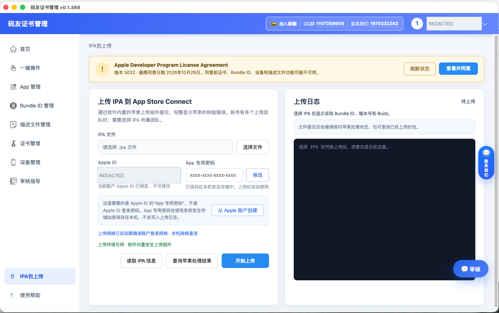
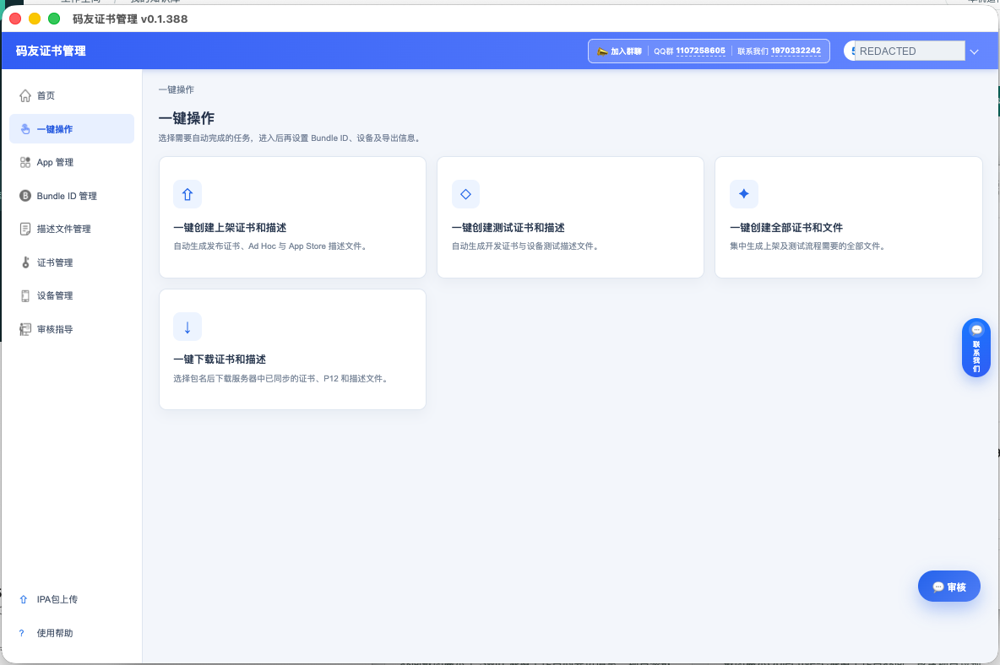
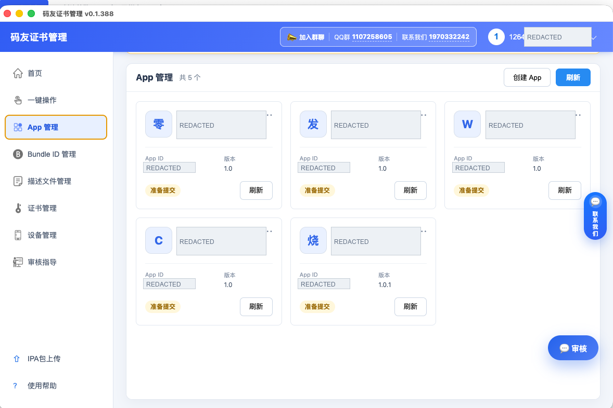
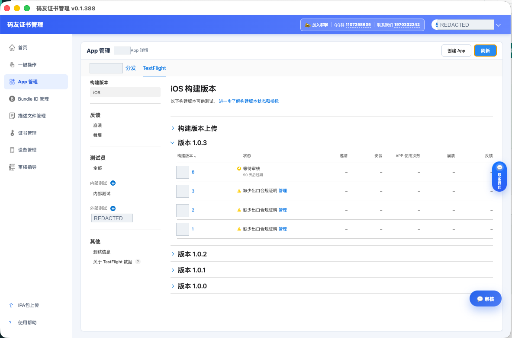
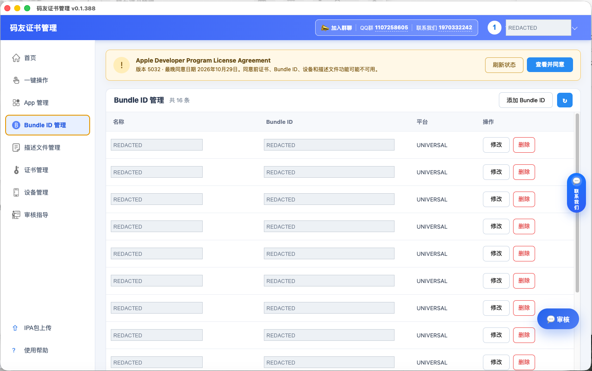
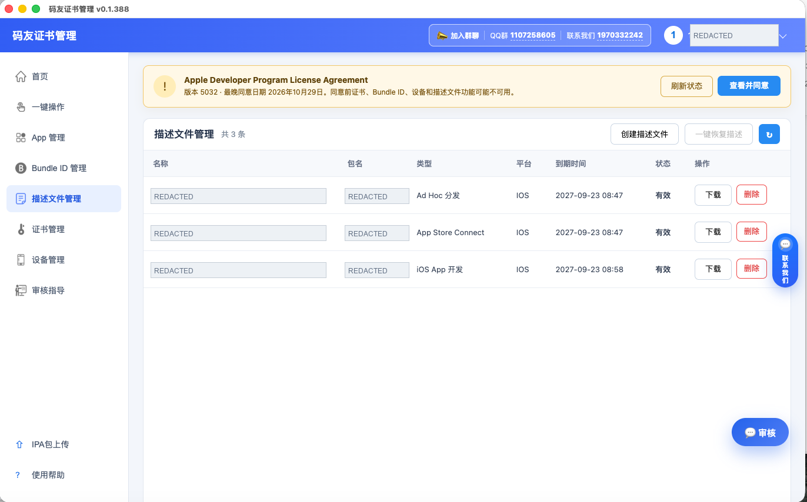
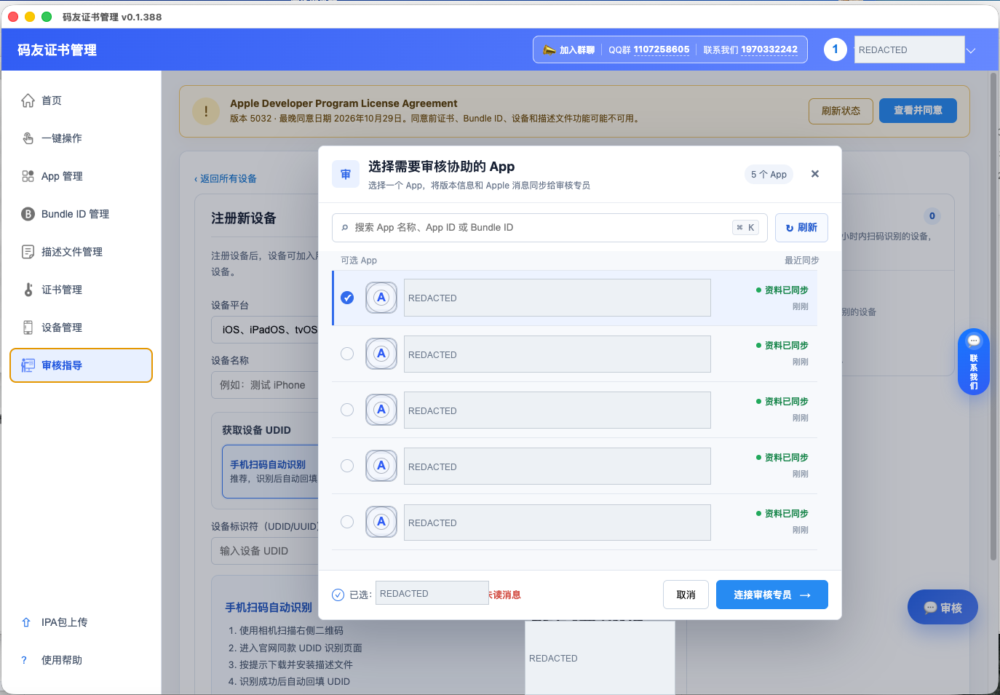

<h1 align="center">码友证书管理 · Mayou IPA Uploader</h1>

<strong>IPA 上传 · iOS 证书管理 · TestFlight 内测 · 上架协助</strong>

从签名材料准备到应用上传，在一个桌面工具中衔接发布流程。

简体中文 · <a href="README.en.md">English</a>

  <a href="#features">核心特性</a> ·
  <a href="#showcase">功能展示</a> ·
  <a href="#quick-start">快速开始</a> ·
  <a href="#download">下载安装</a> ·
  <a href="source/README.md">客户端源码</a> ·
  <a href="#contact">联系交流</a>

---

**码友证书管理（Mayou IPA Uploader）** 是一款面向 iOS 开发者、独立开发者与应用上架团队的 **IPA 上传工具与 iOS 证书管理工具**。支持向 **App Store Connect 上传 IPA**，集中管理 Apple 开发与发布证书、P12、描述文件（Provisioning Profiles）、Bundle ID、测试设备和 **TestFlight 内测**。

已有签名好的 IPA 包，即可在客户端选择文件、核对团队并发起上传，随后查看苹果处理结果，继续推进内测与上架准备。

> **源码与许可**：本仓库已整理真实客户端源码，见 [source](source/)；第一方代码采用 [MIT 许可证](LICENSE)。开发环境及外部组件要求见 [源码说明](source/README.md)，验证结果见 [源码验证记录](docs/源码验证记录.md)，第三方组件适用各自许可。

Mayou IPA Uploader is a desktop tool for IPA uploads to App Store Connect, iOS certificate and provisioning profile management, and TestFlight testing. See the [English introduction](README.en.md).

## 特性

- **桌面可视化界面**：证书、应用、设备与 IPA 上传集中管理，常用操作在同一客户端完成。
- **内置上传环境**：使用软件内置的苹果上传组件，上传 IPA 无需额外安装 Xcode、Transporter、Python 或外部 Java。
- **一键准备材料**：按上架、测试场景创建证书与描述文件，支持按包名集中下载已同步的证书、P12 与描述文件。
- **账户与团队管理**：支持切换 Apple 开发者账户，上传前明确选择目标团队，按实际权限操作。
- **上传结果追踪**：读取 IPA 的 Bundle ID、版本号和 Build，结合苹果回执核对构建，展示处理进度与错误详情。
- **核心功能**：
  - **IPA 包上传（IPA Upload）**：读取包信息、上传到 App Store Connect、查询苹果处理结果。
  - **App 管理（Apps）**：创建应用，集中查看应用版本与状态。
  - **Bundle ID 管理（Identifiers）**：查看、添加、修改与删除应用标识。
  - **证书管理（Certificates）**：创建开发、发布与推送证书，下载 P12、修改密码及撤销证书。
  - **描述文件管理（Profiles）**：创建、下载与删除开发、Ad Hoc 和 App Store Connect 描述文件。
  - **设备管理（Devices）**：注册、批量导入、搜索、重命名与停用测试设备。
  - **TestFlight 管理**：查看构建状态，管理测试内容、群组、测试员与反馈。
  - **审核指导**：按 App 关联版本资料与 Apple 消息，连接审核专员获取协助。

## 功能展示

以下为 **0.1.388** 版本实际界面，账户及应用标识已遮挡。每个模块按“用途 → 操作 → 截图”展示；点击截图可查看大图。

### 1. IPA 上传与结果查询

**选择 IPA，核对应用信息，提交后继续跟进苹果处理状态。**

- **上传前**：读取 Bundle ID、版本号和 Build，选择对应开发者团队。
- **上传中**：使用内置上传组件，查看进度和苹果返回的校验错误。
- **上传后**：查询对应构建处理结果，再进入 TestFlight 跟进测试。

---

### 2. 一键创建与下载签名材料

**按使用场景准备证书与描述文件，减少逐项创建和下载。**

- **上架准备**：创建发布证书、Ad Hoc 与 App Store 描述文件。
- **测试准备**：创建开发证书与设备调试描述文件。
- **集中下载**：按包名下载已同步的证书、P12 和描述文件。

---

### 3. App 管理

**集中查看多个应用的版本和当前状态。**

- **应用列表**：以卡片显示应用名称、App ID、版本与状态。
- **常用操作**：创建 App、刷新应用信息，进入对应应用详情。

---

### 4. TestFlight 内测管理

**上传完成后，继续查看构建并组织内外部测试。**

- **构建状态**：按版本查看 Build，识别等待审核、缺少出口合规等状态。
- **测试协作**：管理测试内容、群组与测试员，查看崩溃和截屏反馈。

---

### 5. Bundle ID 管理

**集中管理应用标识，衔接证书和描述文件配置。**

- **标识列表**：查看名称、Bundle ID 和平台。
- **常用操作**：添加、修改与删除应用标识。

---

### 6. 描述文件管理

**按类型、到期时间和状态查看签名配置。**

- **文件类型**：开发、Ad Hoc 与 App Store Connect 描述文件。
- **常用操作**：创建、下载和删除，核对包名、平台与有效状态。

---

### 7. 审核指导与专员协助

**选择需要协助的 App，围绕版本资料和 Apple 消息沟通审核问题。**

- **资料关联**：按 App 查找并查看资料同步状态。
- **专员协作**：连接审核专员，沟通后续处理；审核结果由 Apple 决定。

---

### 8. 证书与设备管理

| 模块 | 主要操作 |
| --- | --- |
| **证书管理** | 创建开发、发布及推送证书，下载 P12、修改密码、撤销证书 |
| **设备管理** | 搜索、批量导入、注册、重命名与停用设备 |
| **UDID 获取** | 手机扫码、Mac 自动识别、Windows Apple Devices / iTunes 入口 |
| **账户与团队** | 切换开发者账户，按实际团队权限操作 |

## 快速开始

### 1. 准备文件与账户

- **IPA**：已完成构建和签名，适用于 App Store 分发。
- **应用**：App Store Connect 中已有对应应用。
- **权限**：Apple 开发者账户具有该应用的访问和上传权限。
- **上传凭据**：按客户端提示准备 App 专用密码，完成必要的登录验证。

### 2. 在客户端上传

1. **登录账户**，确认当前开发者团队。
2. 打开 **IPA 包上传**，选择文件，点击 **读取 IPA 信息**。
3. 核对 **Bundle ID、版本号、Build** 与目标团队。
4. 填写上传凭据，点击 **开始上传**。
5. 点击 **查询苹果处理结果**，确认对应构建状态。
6. 进入 **TestFlight**，补充必要信息并安排测试。

Windows 上传还需选择与 IPA **同次导出**的 AppStoreInfo.plist，软件会核对其中的应用和版本信息。

### 3. 理解上传状态

| 状态 | 含义与下一步 |
| --- | --- |
| **文件已提交** | 苹果已接收文件，继续等待处理 |
| **苹果处理中** | 处理尚未结束，稍后查询 |
| **处理完成** | 对应有效构建已确认，继续检查测试状态 |
| **需补充出口合规** | 根据应用实际情况补充信息 |
| **文件已存在／结果未确认** | 继续核对构建和回执，查看具体提示 |
| **处理失败** | 查看苹果错误详情，修正后再推进 |

> **状态说明**：文件已提交、构建处理完成、TestFlight 可测试、App Store 审核通过，分别代表不同阶段。

## 下载与安装

| 项目 | 当前说明 |
| --- | --- |
| **版本** | 0.1.388 |
| **已整理安装包** | 码友证书管理-0.1.388-mac-arm64.dmg |
| **适用设备** | macOS · Apple Silicon Mac |
| **Windows** | 已有适配，待发布对应安装包 |
| **Intel Mac / Linux** | 本仓库暂未提供安装包 |

请在本仓库 **Releases** 查找已发布版本；尚未发布时，可通过下方联系方式获取。打开 DMG，将应用拖入“应用程序”后启动。

## 适用场景

- **已有 IPA，需要上传到 App Store Connect**：在客户端选择已签名文件，核对团队与版本后提交。
- **需要创建 iOS 证书和描述文件**：按开发测试、Ad Hoc 或 App Store 分发场景准备签名材料。
- **需要管理 TestFlight 内测**：查看构建处理状态、补充测试信息并管理测试群组。
- **使用 Flutter、Unity 或 uni-app 开发 iOS 应用**：接收已有构建流程导出的、符合分发要求的 IPA，继续完成上传和测试管理。

工具处理已构建并签名的 IPA，不提供 Flutter、Unity 或 uni-app 的项目编译服务。

## IPA 上传与 iOS 证书管理常见问题

<strong>上传 IPA 需要安装 Xcode 吗？</strong>

本软件的 IPA 上传使用内置运行环境，无需额外安装 Xcode。生成 IPA 所需的构建环境取决于你的项目和打包方式。

<strong>上传后为什么没有立即出现可测试版本？</strong>

苹果接收文件后还需异步处理。构建处理完成后，可能还需补充出口合规或测试信息，请查看对应构建的实际状态。

<strong>源码在哪里？是否采用开源许可？</strong>

真实客户端代码位于 source 目录，第一方源码采用 MIT 许可，可按许可证使用、修改和分发。码友服务端与 Apple 服务不包含在本仓库；第三方运行时和素材适用各自条款。源码许可不代表在线服务、审核协助或现成官方安装包的商业服务免费。

## 联系与交流

| 渠道 | 联系方式 |
| --- | --- |
| **交流 QQ 群** | **1107258605** |
| **联系 QQ** | **1970332242** |
| **问题反馈** | 本仓库 Issues：附软件版本、系统版本、复现步骤与错误提示 |

提交日志或截图前，请遮盖账户密码、验证码、会话信息、P12 密码和私钥等敏感内容。具体功能受 Apple 权限、团队类型、软件授权与服务状态影响。

欢迎 **Star 收藏**，分享给有 IPA 上传、iOS 证书管理和 TestFlight 内测需求的朋友。
